# Mirage — Cloud Deception Platform

An AWS hub-spoke deception platform for detecting insider threats and lateral movement. It
deploys realistic-looking decoy infrastructure (IAM roles, S3 buckets, secrets, SSM parameters,
and more) across your AWS accounts and routes any interaction with one straight to an alert. Any
touch of a decoy is a confirmed threat — there's no legitimate reason for anyone to reach one.

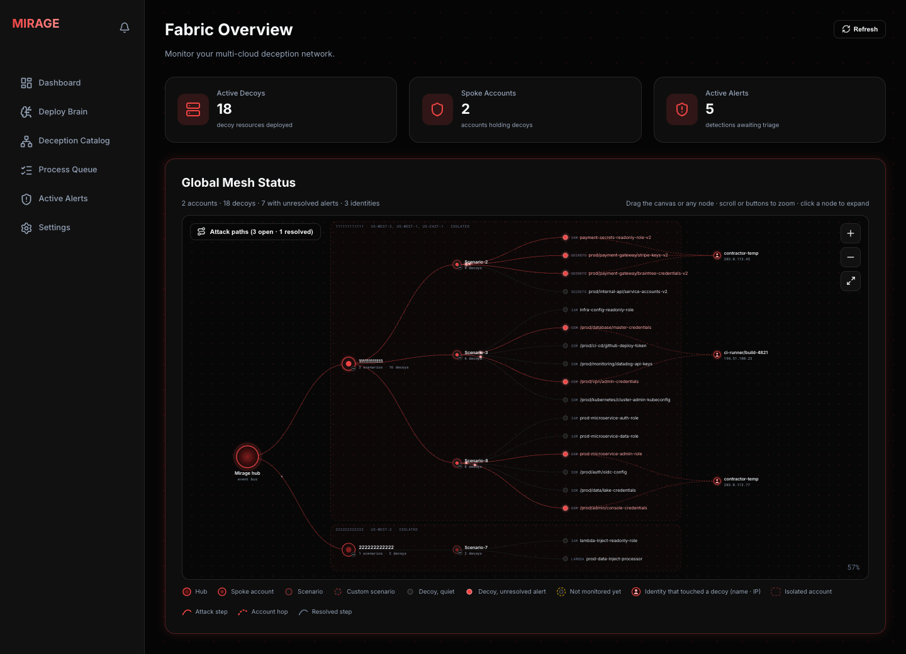

## Contents

- [How it works](#how-it-works)
- [Status](#status)
- [Install](#install)
  - [Before you start](#before-you-start)
  - [1. Install the hub](#1-install-the-hub)
  - [2. Deploy the brain](#2-deploy-the-brain)
  - [3. Make sure CloudTrail covers your spokes](#3-make-sure-cloudtrail-covers-your-spokes)
  - [4. Onboard a spoke](#4-onboard-a-spoke)
  - [5. Deploy decoys and push their rules](#5-deploy-decoys-and-push-their-rules)
  - [6. Touch a decoy and watch the alert](#6-touch-a-decoy-and-watch-the-alert)
- [Portal tour](#portal-tour)
  - [Dashboard](#dashboard)
  - [Deploy Brain](#deploy-brain)
  - [Deception Catalog](#deception-catalog)
  - [Active Rules](#active-rules)
  - [Active Scenarios](#active-scenarios)
  - [History](#history)
  - [Process Queue](#process-queue)
  - [Alerts](#alerts)
- [Uninstall](#uninstall)
- [Documentation map](#documentation-map)
- [Repo layout](#repo-layout)
- [Security](#security)
- [Cost](#cost)

## How it works

- **Hub account** — the monitoring brain: an EventBridge bus, a Lambda event processor, SNS
  alerts, a DynamoDB state table, and the orchestration portal (a Next.js app).
- **Spoke account(s)** — host the decoy resources plus EventBridge rules that forward any
  CloudTrail hit on them back to the hub: one per region with decoys, and one for the role
  decoys in every region (roles can be assumed through any region's STS endpoint).
- **19 decoy scenarios**, each real Terraform (`main.tf`/`outputs.tf`) plus an `abuse.sh` that
  walks the attack chain end-to-end, so you can see exactly what fires a detection and why.

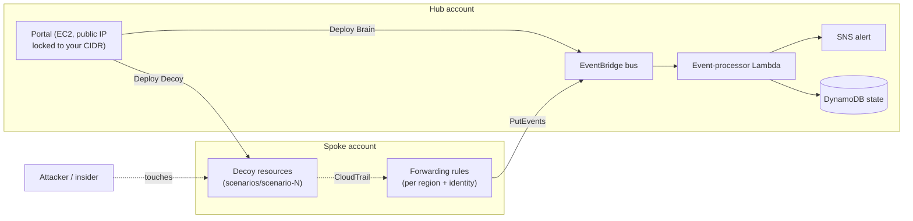

## Status

A working proof of concept: the full deploy → detect → alert path runs end-to-end. The portal
has **no application-layer authentication yet** — treat that as explicitly out of scope for now,
not an oversight; see [Security](#security) below. RBAC is the next thing being built.

## Install

One command installs the hub; the rest happens in the portal. The full walkthrough, with
troubleshooting, is in [`docs/GETTING_STARTED.md`](docs/GETTING_STARTED.md).

### Before you start

- An **AWS Organization** — the hub-to-spoke trust is scoped to it.
- A **hub account** and at least one **spoke account** in it (the same account works for a first
  trial; a separate spoke is closer to real use).
- Admin access to both through the AWS console. Everything below runs in **AWS CloudShell**.

### 1. Install the hub

In the hub account, open **CloudShell** and paste:

```bash
bash <(curl -fsSL https://raw.githubusercontent.com/MirageDeception/Mirage_Cloud_Deception/main/install.sh)
```

It asks how you want to reach the portal:

| Choice | What you answer | How you open the portal |
|---|---|---|
| **1. Direct URL** (default) | Your laptop's public IP (from https://checkip.amazonaws.com) and an SSH public key, or Enter to create one | `http://<host-ip>:3000`, reachable from your IP only |
| **2. SSM tunnel** | Nothing more | Run the printed tunnel command on your laptop (AWS CLI + Session Manager plugin), then open `http://localhost:3000` |

It then creates a VPC, one `t3.medium` host (about $35/month while running), three IAM roles and
an S3 state bucket, and builds and starts the portal. That takes 10–15 minutes and finishes only
once the portal is serving. If CloudShell times out meanwhile, the install keeps going: run the
same command again later and it prints the details, including the command for step 4.

### 2. Deploy the brain

Portal → **Deploy Brain** → enter your alert email → **Deploy Monitoring Brain**. Progress shows
on **Process Queue** (about 3 minutes). Then **confirm the subscription email** AWS sends you —
alerts never arrive until you do.

### 3. Make sure CloudTrail covers your spokes

Decoy touches are seen through CloudTrail. Easiest: in the Organization's management account,
create a trail with **"Enable for all accounts in my organization"**. S3 reads (`GetObject`) are
*data events*: turn those on for the trail if you deploy S3 scenarios.

### 4. Onboard a spoke

Sign in to the spoke account as an **admin user (not root)**, open CloudShell and paste the
`SpokeOnboardCommand` the installer printed (also in the hub stack's **Outputs**). It creates the
two roles Mirage needs there: one the portal deploys decoys with, one that forwards detections to
the hub.

### 5. Deploy decoys and push their rules

1. Portal → **Deception Catalog** → enter the spoke account id → pick the **Deploy Region** →
   tick scenarios → **Deploy Selected Paths**.
2. Open **Active Rules** (a badge counts rules waiting for review) and push them: the
   **Identity** rule first (it watches role decoys in every region), then each **Regional** rule.
   Until a decoy's rule is pushed it is deployed but not monitored — the Dashboard marks it with
   an amber ring.

If a deploy fails partway, Mirage removes whatever that attempt had created, so nothing is left
behind that the portal cannot see.

### 6. Touch a decoy and watch the alert

In the spoke's CloudShell, as a **non-root** user, run a scenario's attack script, e.g.
scenario-2:

```bash
git clone -q --depth 1 https://github.com/MirageDeception/Mirage_Cloud_Deception.git ~/mirage 2>/dev/null; bash ~/mirage/scenarios/scenario-2/abuse.sh
```

Within a minute an email arrives and the alert shows on the portal's **Alerts** page.

To just click around the UI locally, with no AWS:
`cd portal && npm install && STORAGE_BACKEND=local npm run dev`.

## Portal tour

The screenshots use made-up demo data: example account ids (`111111111111`), documentation IP
ranges and invented users.

### Dashboard


The overview. The three counts are live decoys, spoke accounts holding them, and alerts waiting
for triage. A count shows **—** instead of 0 when its store cannot be read, because "nothing
there" and "could not check" are different answers.

The **Global Mesh** draws the whole fabric left to right: the hub, each spoke account, its
scenarios, their decoys, and on the far right every **identity** (caller name and source IP)
that touched a decoy. Click an account or scenario to expand it; drag, scroll or use the buttons
to zoom. A red decoy has an unresolved alert, an amber ring means its rule is not pushed yet, and
**Attack paths** replays the decoys one actor touched, in order.

### Deploy Brain

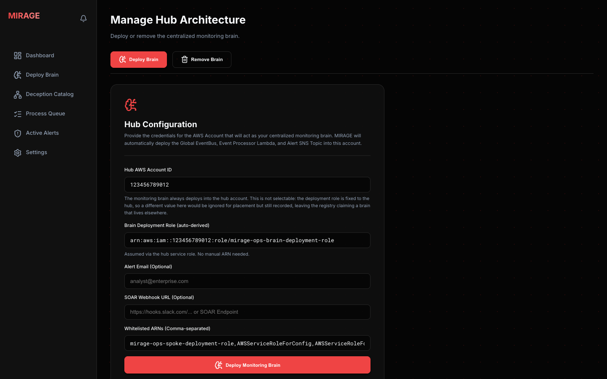

Deploys or removes the monitoring brain in the hub account: the EventBridge bus, the Lambda that
turns a CloudTrail event into an alert, the SNS topic (email and an optional SOAR webhook) and
the state tables. The account and deployment role are fixed to the hub. **Whitelisted ARNs** are
roles whose decoy touches never alert — pre-filled with Mirage's own deploy role and AWS's own
scanners; see [`docs/ALERT-WHITELIST.md`](docs/ALERT-WHITELIST.md).

### Deception Catalog

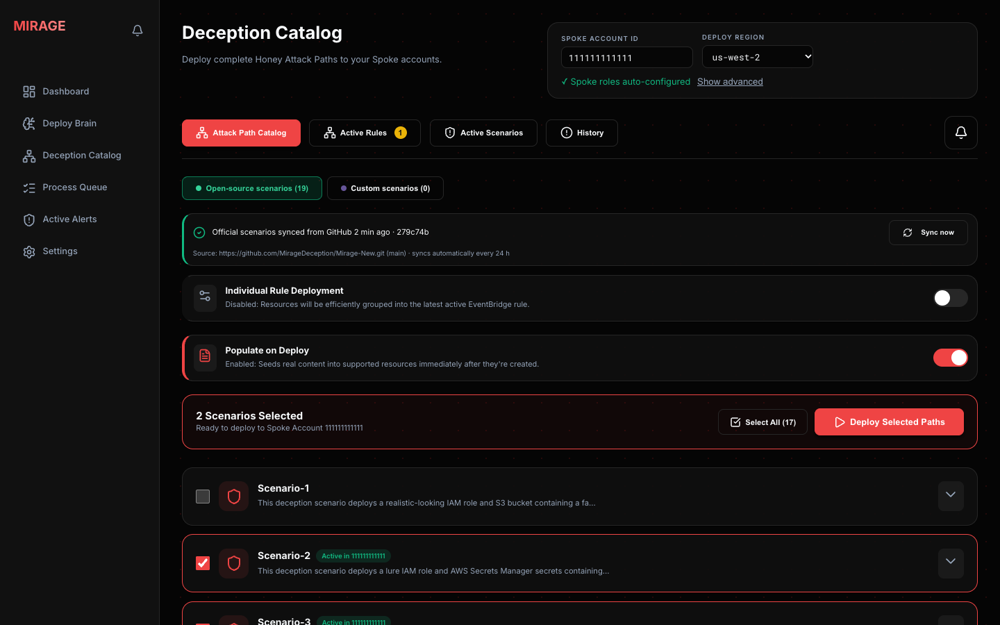

Where decoys are deployed. Enter the **spoke account id** (the roles are derived from it; *Show
advanced* lets you override the forwarding role or hub bus) and the **Deploy Region**, tick
scenarios, and **Deploy Selected Paths**. Each scenario says what it baits; expand it for the
resources it creates.

- **Open-source scenarios** sync from this GitHub repo automatically (daily, or *Sync now*).
  Every synced scenario passes the same checker before it can be deployed.
- **Custom scenarios** are your own Terraform, uploaded as a zip and checked strictly: no
  commands on the hub, no remote modules, no file paths outside the scenario folder.
- **Populate on Deploy** seeds realistic fake content into the decoys, because an empty secret
  or bucket looks like a trap and an attacker moves on without touching it.

### Active Rules

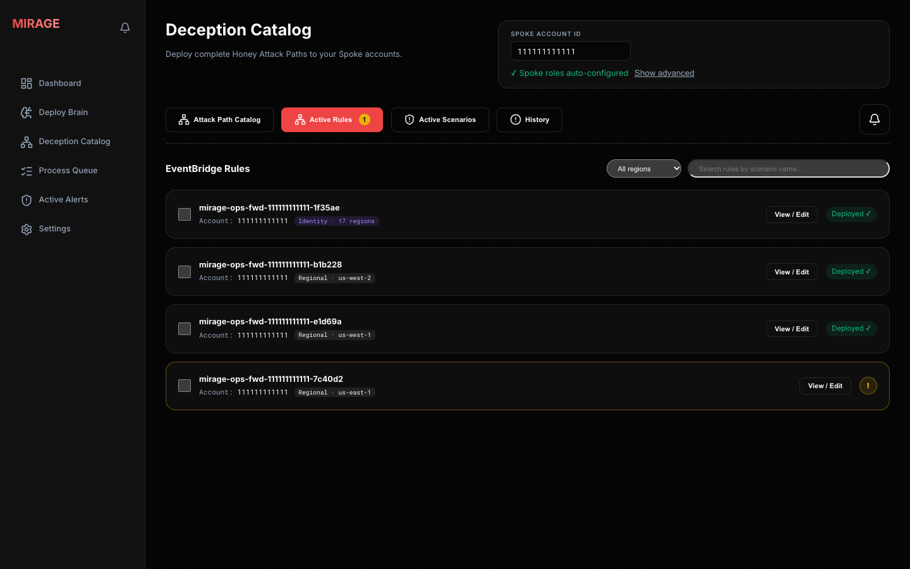

The EventBridge rules in each spoke that forward decoy activity to the hub. Deploying or tearing
down decoys only *plans* rule changes; nothing reaches AWS until you push it here. A yellow **!**
marks a rule waiting for review.

- **Regional** rules — one per region with decoys, matching those decoys by name.
- **Identity** rule — one per account, pushed to every region, because a role can be assumed
  through any region's STS endpoint.

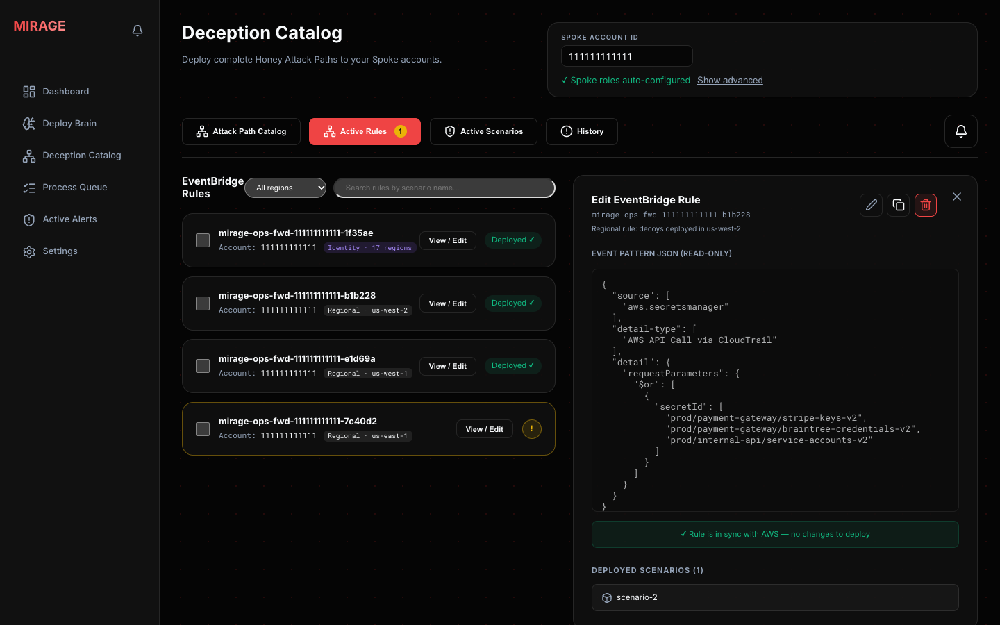

**View / Edit** opens a rule: its event pattern, whether it matches what is deployed in AWS, the
scenarios it watches, and (for a pending change) a diff to deploy or reject. Rules act on their own account
and region; the account box at the top is only needed for new deploys.

### Active Scenarios

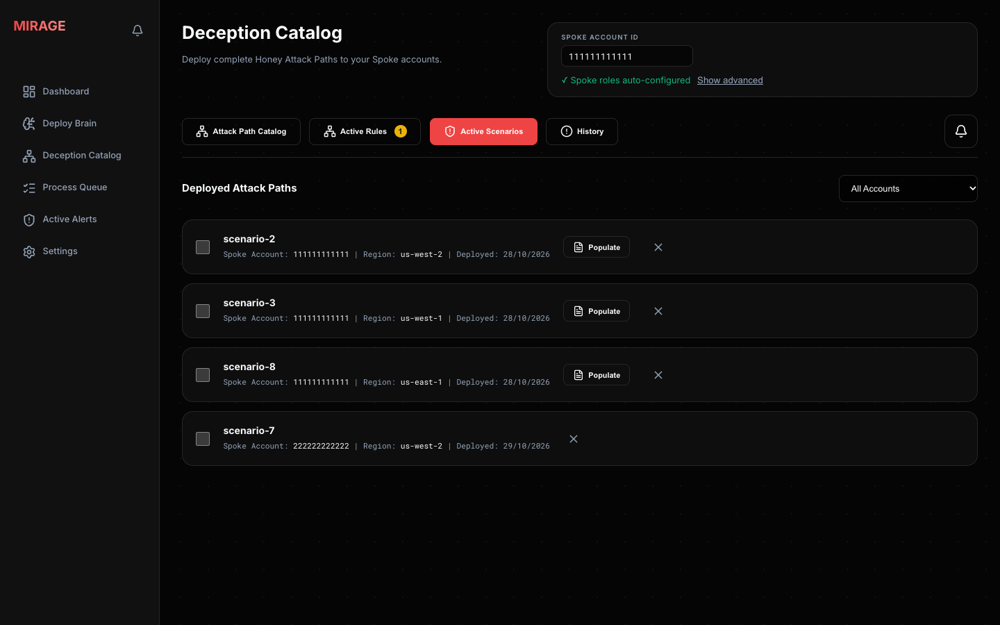

Every deployed scenario with its account, region and deploy date. Tick scenarios and **Teardown
Selected** to destroy their decoys; the rules that watched them are then planned for removal.
**Populate** re-seeds a scenario's fake content. The **✕** only hides an entry in this browser
until the page reloads — it destroys nothing.

### History

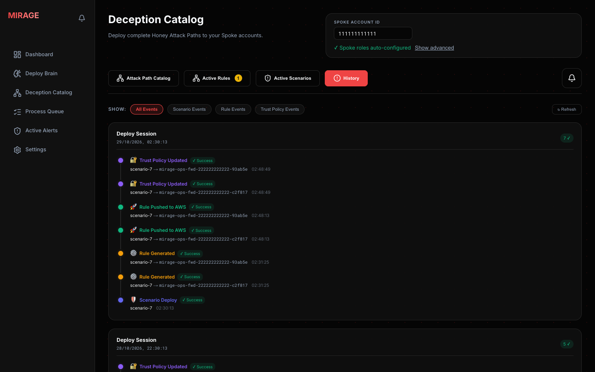

An audit trail grouped by session: each deploy with the rules generated for it, their pushes to
AWS and the forwarding-role trust updates, plus teardowns. Filter by scenario, rule or trust
events.

### Process Queue

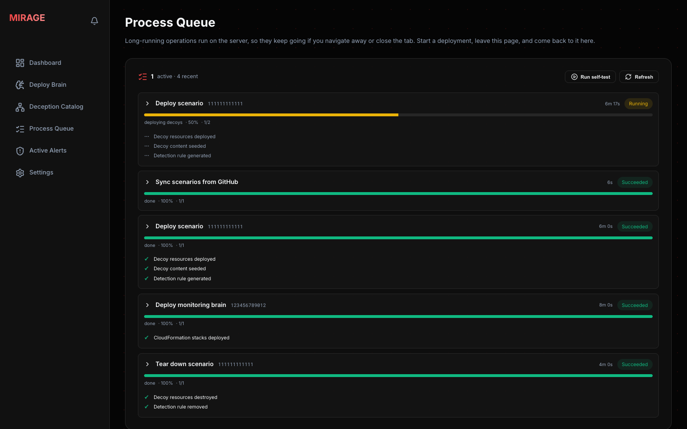

Deploys, teardowns, brain operations and scenario syncs run on the server, so they keep going if
you close the tab. Each job shows its progress and a checklist of the real steps it performs;
expand one for its log. A job cut short by a portal restart is marked interrupted with what to
check before retrying.

### Alerts

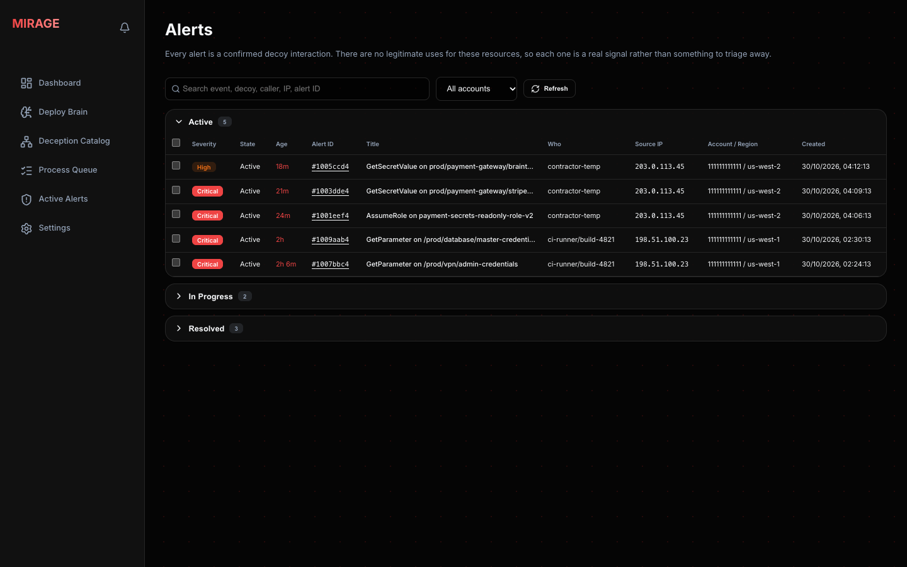

Every decoy touch, grouped by state: **Active**, **In Progress** and **Resolved**. Each row shows
severity (**Critical** when the call succeeded, **High** when AWS denied it), age, the event and
decoy, who did it, from which IP, and the account and region. Search and filter by account; tick
rows to change their state together.

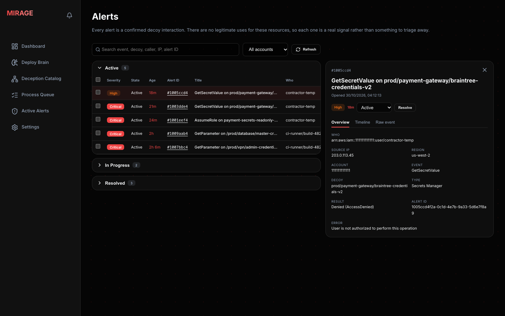

Click an alert for its details: who, source IP, region, account, decoy, and whether the call
worked. Change the state or **Resolve** it here. **Timeline** lists when it was detected and
every state change; **Raw event** shows the full CloudTrail record. Alerts also arrive by email
(and SOAR webhook) the moment they fire.

**Settings** is a placeholder for upcoming options (SSO, credential management).

## Uninstall

Order matters: decoys are destroyed *through* the spoke roles, so they go first.

1. **Portal → Deception Catalog → Active Scenarios:** tear down every deployed scenario and wait
   for the jobs on **Process Queue** to finish.
2. **Hub account CloudShell:**
   ```bash
   bash <(curl -fsSL https://raw.githubusercontent.com/MirageDeception/Mirage_Cloud_Deception/main/uninstall.sh)
   ```
   - It first checks the state bucket and **refuses while any decoy still has live resources**,
     listing them. Tear those down in the portal and run it again.
   - You confirm by typing the hub account id. It then removes the brain (and with it all stored
     alerts) and the hub stack: portal host, VPC and hub roles.
   - It asks separately before deleting the two things the stack keeps on purpose: the Terraform
     **state bucket** and the disk **encryption key** (scheduled for deletion after 7 days, which
     you can cancel).
3. **Each spoke account's CloudShell:** paste the offboard command the uninstaller prints. It
   removes Mirage's two roles there, and refuses while forwarding rules remain.

Your CloudTrail trails and the email address are left alone (the email subscription goes with
the brain).

## Documentation map

| Doc | What |
|---|---|
| [`docs/GETTING_STARTED.md`](docs/GETTING_STARTED.md) | The real end-to-end path, step by step |
| [`docs/ARCHITECTURE.md`](docs/ARCHITECTURE.md) | Detection pipeline, auth chain, state model, forwarding rules |
| [`docs/SCENARIOS.md`](docs/SCENARIOS.md) | The 19-scenario catalog |
| [`docs/ALERT-WHITELIST.md`](docs/ALERT-WHITELIST.md) | Suppressing known-noisy roles (scanners, your own deploy role) |
| [`docs/SCP-GUIDE.md`](docs/SCP-GUIDE.md) | Optional org-level guardrails — apply after your PoC works |
| [`hub/README.md`](hub/README.md) | The hub bootstrap template — parameters, access-model tradeoff |
| [`advanced/ssm-private/README.md`](advanced/ssm-private/README.md) | Optional hardened posture (no public IP, SSM-only) instead of the default |

## Repo layout

```
portal/            Next.js orchestration portal (the only deliverable that runs continuously)
scenarios/         19 decoy scenarios — Terraform (main.tf/outputs.tf) + abuse.sh + fake-data/
hub/               hub-bootstrap.yaml — the default hub deploy (CloudFormation)
iam/spoke/         Spoke IAM roles (deployment, forwarding) — per-account local Terraform state
scp/               Optional AWS Organizations SCPs (hub + spoke guardrails)
scripts/           sync-env-from-stack.sh, spoke onboarding, attack simulation, SSO auth helper
advanced/          Optional hardened path: no public IP, SSM-only access (vpc/ec2/iam-hub)
docs/              Getting started, architecture, scenario catalog, SCPs, alert tuning
```

Decoys are **Terraform**. Each `scenarios/scenario-N/` has `main.tf` + `outputs.tf` (what the
portal deploys) alongside `abuse.sh` + `fake-data/` (attack simulation + seed content).

## Security

- **No application-layer login on the portal.** It's protected only by network access (the
  security-group CIDR you set when deploying `hub/hub-bootstrap.yaml`, or, if you use the
  `advanced/ssm-private/` path instead, by having no public IP at all). Don't expose it beyond
  your own machine/VPN. RBAC is planned, not yet built.
- Every hub-infra resource name derives from one `ResourcePrefix` (default `mirage-ops`) — set
  it once in `hub/hub-bootstrap.yaml`'s parameters if you want it under a different name.
- Decoy **data-plane** access (`GetObject`, `GetSecretValue`, ...) is deliberately left reachable
  by any principal — touching a decoy *is* the detection signal. Only the decoy
  **management-plane** (create/update/delete) is locked to the spoke-deployment role, which may
  not attach AWS admin policies (`AdministratorAccess`, `PowerUserAccess`, `IAMFullAccess`).
- Every scenario is internal-only (no public-facing resource) **except scenario-4** (the one EC2
  scenario), which supports an explicit, opt-in `allowed_cidr_blocks` override if you want it
  externally reachable — never widen that by default.

## Cost

Roughly $3-4/month for a full set of decoy scenarios in one spoke account (mostly S3/DynamoDB/SSM
minimums — nothing here runs always-on compute except the portal host itself, about $35/month).

---

> ⚠️ **Secrets:** do not commit real credentials, `*.tfstate`, or an env file containing
> `MIRAGE_SPOKE_EXTERNAL_ID`. See `.gitignore`. Decoy "credentials" under `scenarios/*/fake-data/`
> are intentionally fake and marked EXPIRED.
