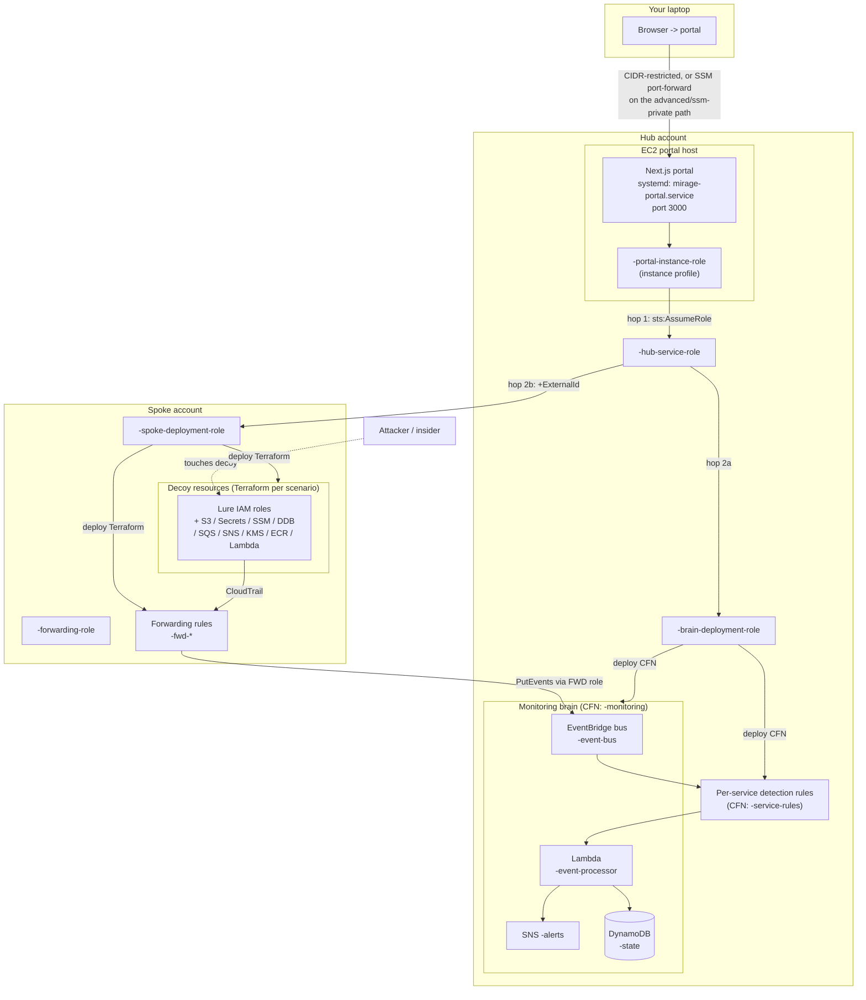
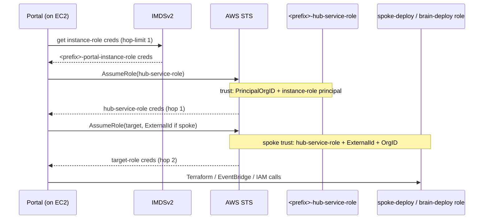
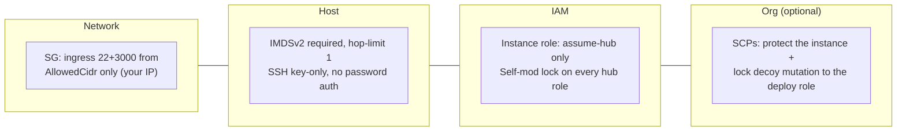
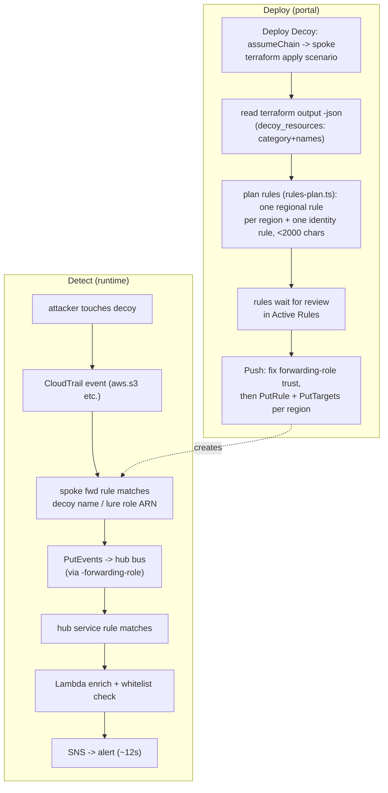

# Mirage — Architecture

How the hub, spoke, and portal fit together: the credential chain, the DynamoDB state model, and
the detection flow from a decoy touch to an alert.

---

## 1. System overview (hub / spoke / portal)

`<prefix>` is `ResourcePrefix` (default `mirage-ops`), set once when you deploy
`hub/hub-bootstrap.yaml` — every hub-infra resource name derives from it.

---

## 2. Credential chain (two-hop, no interactive SSO)

The portal's ambient identity is the **EC2 instance role**. It cannot reach the spoke/brain
roles directly — those trust only the hub service role. Every privileged action chains two hops
via `portal/src/lib/aws-auth.ts` (`assumeChain`).

**Role trust summary**

| Role | Trusts | Extra condition |
|---|---|---|
| `<prefix>-hub-service-role` | the portal instance role (+ optional operator ARNs) | `aws:PrincipalOrgID` |
| `<prefix>-brain-deployment-role` | `<prefix>-hub-service-role` (+ optional operator ARNs) | — |
| `<prefix>-spoke-deployment-role` | `<prefix>-hub-service-role` (+ optional operator ARNs) | `sts:ExternalId` + `aws:PrincipalOrgID` |
| `<prefix>-forwarding-role` | `events.amazonaws.com` | used by EventBridge to PutEvents on the hub bus |

Every role above carries a **self-modification lock**: an explicit IAM `Deny` on
`PutRolePolicy`/`UpdateAssumeRolePolicy`/`DeleteRole`/etc. against itself, except for principals
in `BreakGlassAdminArns`. A stolen credential that can assume one of these roles still can't
widen it or alter its trust to persist.

---

## 3. Security posture

- **Layers 1-3 are live from the moment you deploy `hub/hub-bootstrap.yaml`.** Layer 4
  (`scp/`, see [`docs/SCP-GUIDE.md`](SCP-GUIDE.md)) is an explicit opt-in follow-up for
  org-wide rollout, not required for a single-account trial.
- **The portal has no application-layer login.** Layer 1 (the CIDR allowlist) is the only thing
  standing between the internet and a console that can deploy/destroy cross-account
  infrastructure. Don't widen `AllowedCidr`. RBAC is planned, not yet built.
- **Deliberate open door:** the decoy **data plane** (`GetObject`, `GetSecretValue`, ...) stays
  reachable by any principal — an attacker touching a decoy *is* the detection signal. Only the
  decoy **management plane** (create/update/delete) is locked to the spoke-deploy role.
- Prefer the original no-public-IP posture instead? See
  [`advanced/ssm-private/README.md`](../advanced/ssm-private/README.md) — same roles and
  self-mod locks, SSM-only access, no CIDR to manage, more moving parts (NAT or no NAT, VPC
  interface endpoints).

---

## 4. DynamoDB single-table (`<prefix>-state`)

One table holds all portal state, discriminated by PK/SK prefixes; `v0` = current, `v1` =
previous (one-deep rollback).

| Item type | PK | SK | Key attributes |
|---|---|---|---|
| Rule | `ACCT#<acct>` | `RULE#<name>#v0` / `#v1` | eventPattern, deployedPattern, status, charCount, limitReached, kind (`regional`/`identity`), region (regional only), regionStatus (identity only), version |
| Scenario / decoys | `ACCT#<acct>` | `SCENARIO#<id>#v0` / `#v1` | decoys[]{name,category}, deployedAt, tfstateKey (`accounts/<acct>/<region>/<id>/…`, which is where the scenario's region is read from), version |
| Spoke | `SPOKE#<acct>` | `META` | alias, region, registeredAt |
| Brain | `BRAIN#<acct>` | `META` | globalBusArn, region, status, deployedAt |
| History | `HISTORY#<date>` | `EVENT#<ts>-<id>` | type, scenarioId, ruleName, status |

- Access is by `Query` on PK + `begins_with(SK)` or a small `Scan`.
- `STORAGE_BACKEND=aws` uses this table (created by Deploy Brain); `local` uses flat files
  (`portal/db_*.json`) for exploring the UI before a brain exists.
- Detections (decoy-access alerts) live in a **separate** `<prefix>-alerts` table — kept apart so
  the event-processor Lambda's append-only grant can never reach control-plane items. See
  `portal/src/lib/detections.ts`.

---

## 5. Rule-generation & detection flow

> EventBridge rejects a hand-crafted `PutEvents` with a reserved `aws.*` source
> (`NotAuthorizedForSourceException`) — real detection only works because the forwarding
> **service** relays the genuine CloudTrail event, which is why `abuse.sh`/`probe-decoys.sh`
> exercise real AWS API calls rather than simulating the event.

Some roles are noisy by design (your own deploy role, a CSPM scanner) — see
[`docs/ALERT-WHITELIST.md`](ALERT-WHITELIST.md) for how and when to suppress them, and why the
human-operator SSO role is deliberately never suppressed.

---

## 6. Forwarding rules

Every spoke rule is named `<prefix>-fwd-<account>-<6 hex>` and targets the hub bus through
`<prefix>-forwarding-role`. There are two kinds:

| Kind | Holds | Lives in | Matches |
|---|---|---|---|
| **Regional** | the account's non-role decoys in one region | that region | the decoy names (`name`, `secretId`, `functionName`, ...) for their service |
| **Identity** | every role decoy in the account | every identity region | `aws.sts` `roleArn`; in **us-east-1** also `aws.iam` `roleName` |

Why roles are different: a role can be assumed through **any** region's STS endpoint, and
CloudTrail records `AssumeRole` in the region the caller used (the global endpoint and every IAM
call, such as `GetRole`, are recorded in us-east-1). A regional resource can only be reached
through its own region, so its region's rule is enough.

**Identity regions** are the 17 regions AWS enables by default, plus any region a scenario is
deployed to. `MIRAGE_IDENTITY_REGIONS` (comma-separated) on the portal **replaces** the 17
defaults, so to add opt-in regions your accounts have enabled, list the defaults as well.
Regions with deployed scenarios are always added.

**Lifecycle**

- **Deploy and teardown only propose.** After a deploy or teardown the portal re-plans the
  account's rules from its deployed decoys (`portal/src/lib/rules-plan.ts`, applied by
  `rules-sync.ts`). New rules are `pending`, changed ones `update_available`. Nothing reaches AWS
  until someone pushes it from **Active Rules**, where a badge shows how many rules wait for review.
- **Push the identity rule first.** A regional rule that would drop role conditions is refused
  until the identity rule is deployed everywhere, so roles are never left unwatched in between.
- **Push** writes the rule to its region (regional) or to every identity region, four at a time
  (identity). Each region's result is stored; the rule is `deployed` only if every region worked,
  and **Retry failed regions** re-pushes just the ones that failed.
- **A rule left with nothing to watch is deleted** from AWS in every region it lives in. If a
  delete fails, the record is kept so the next run retries it.
- At most 2000 characters per pattern (measured on the larger us-east-1 form for identity
  rules); a group that outgrows that gets another rule. A pattern with a single condition is sent
  without `$or`, which EventBridge rejects with one entry.

**Forwarding-role trust.** Before every push the portal puts the forwarding role's EventBridge
trust in one fixed form: `aws:SourceAccount` = the account, and `aws:SourceArn` like
`arn:aws:events:*:<account>:rule/<prefix>-fwd-*`. Any region works, and the policy never grows
with the number of rules. `iam/spoke/forwarding-role/main.tf` creates new spokes in this form.

**Upgrading from a version without per-region rules.** Nothing to re-onboard. Old rule records
read as regional rules in us-west-2. After updating the hub, `POST /api/rules/reconcile` with
`{"accountId":"<acct>","dryRun":true}` shows what the re-plan would change; send
`"dryRun":false` to save it, then push the identity rule, then the regional rules. The first push
also fixes an old trust policy that only allowed us-west-2.

**Not covered:** opt-in regions not listed in `MIRAGE_IDENTITY_REGIONS`; listing calls
(`ListFunctions`, `ListSecrets`, ...) that do not name a decoy; replicas of a decoy in another
region (none of the shipped scenarios use one). S3 object reads and other data events also need
the spoke's trail to log data events.

---

## Key files

`hub/hub-bootstrap.yaml` (VPC + EC2 + hub IAM + state bucket), `portal/src/lib/aws-auth.ts`
(the credential chain + role-ARN builder), `portal/src/lib/{db,detections}.ts` (state + alerts),
`portal/src/templates/hub/{monitoring-brain,service-rules}.yaml` (the brain, deployed by the
portal's Deploy Brain), `portal/src/lib/{rules-plan,rules-sync,decoy-match}.ts` (forwarding rules),
`scenarios/*/main.tf` (the decoys), `scp/` +
[`docs/SCP-GUIDE.md`](SCP-GUIDE.md) (optional org-level guardrails).
